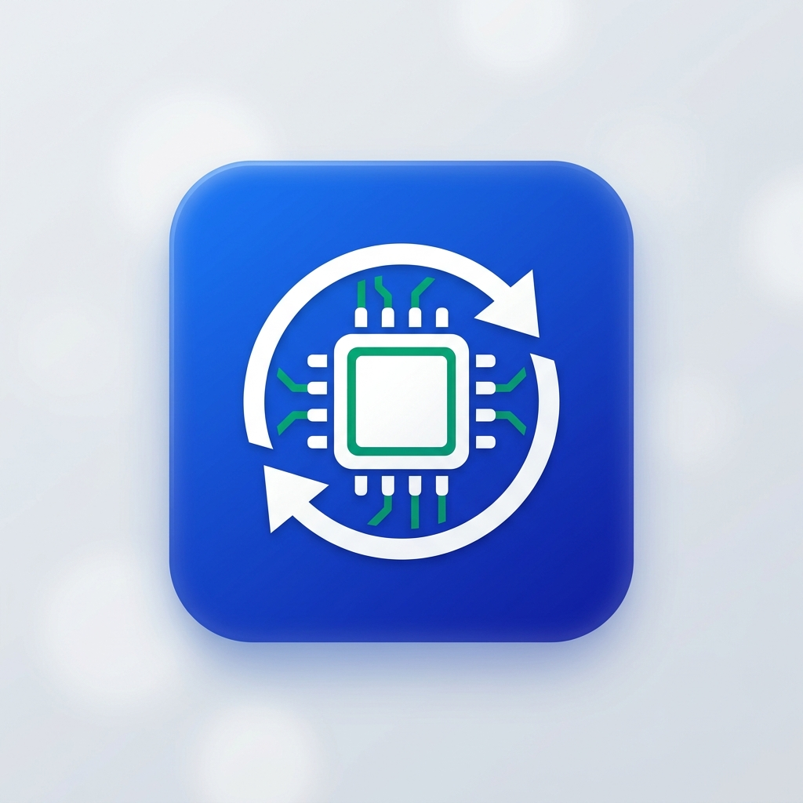

# 🔍 Driver Checker v1.2

<p align="center">
  
  <br>
  <b>Công cụ kiểm tra, cập nhật driver chính chủ từ Microsoft & sao lưu/khôi phục driver offline cho Windows 10/11</b>
</p>

<p align="center">
  
  
  
  
</p>

---

## 🌟 Giới thiệu

**Driver Checker** là phần mềm tiện ích gọn nhẹ (~200KB) giúp giải quyết triệt để vấn đề cài đặt driver sau khi cài lại Windows:
- ❌ **Không cần cài phần mềm bên thứ 3** dễ dính adware/scareware/màn hình xanh (BSOD).
- 🔒 **100% Driver chính chủ Microsoft (WHQL)** được chứng thực và ký điện tử tương thích với từng phiên bản Windows.
- ⚡ **Sao lưu & Khôi phục cực nhanh (Offline):** Backup toàn bộ driver OEM trước khi format, khôi phục lại ngay sau khi cài Win mà **không cần kết nối mạng**.
- 🚀 **Chạy ngay không cần cài đặt**, không phụ thuộc runtime bên ngoài (Windows 10/11 có sẵn .NET Framework 4.8).

---

## 🚀 Tính năng chính

### 1. 🔍 Quét & Cập nhật Driver trực tiếp từ Microsoft (Online)
- Liệt kê toàn bộ linh kiện phần cứng: Card đồ họa (GPU), Card mạng (Wi-Fi/LAN), Âm thanh, Bluetooth, Chipset, USB, Firmware...
- Đối chiếu với **Microsoft Update Catalog** để tìm bản cập nhật driver mới nhất.
- So sánh trực quan giữa **Phiên bản hiện tại** và **Phiên bản mới**.
- Tải và cài đặt 1-Click an toàn.

### 2. 🛡️ Tự động tạo System Restore Point
- Tự động tạo điểm khôi phục hệ thống trước khi cài đặt bất kỳ driver nào, phòng ngừa lỗi không tương thích có thể rollback lại ngay.

### 3. 💾 Sao lưu & Khôi phục Driver (Offline)
- **Sao lưu:** Trích xuất toàn bộ driver OEM của máy ra USB qua `pnputil.exe`.
- **Khôi phục:** Cài đặt lại toàn bộ driver từ bản backup trong 1-2 phút, hữu ích nhất khi máy vừa cài Win chưa nhận card mạng / Wi-Fi.

### 4. ⚡ Hỗ trợ Command-line (CLI) cho Kỹ thuật viên
Tích hợp sẵn vào file `.bat` hoặc kịch bản cài Win tự động:
```cmd
DriverChecker.exe /backup "D:\DriverBackup"
DriverChecker.exe /restore "D:\DriverBackup"
```

---

## 📦 Hướng dẫn sử dụng

### Quy trình chuẩn khi cài lại Win:

1. **Trước khi cài Win:**
   - Mở tab **Sao Lưu & Khôi Phục Driver** -> Bấm **Bắt Đầu Sao Lưu** ra USB (hoặc click đúp file `Release/1-Click-SaoLuu-Driver.bat`).
2. **Sau khi cài Win:**
   - **Cách 1 (Không có mạng):** Chạy `Release/1-Click-KhoiPhuc-Driver.bat` bằng quyền Administrator để nhận lại toàn bộ driver gốc.
   - **Cách 2 (Có mạng):** Mở `DriverChecker.exe` để quét và cập nhật các driver mới nhất từ Microsoft.

---

## 🛠️ Biên dịch mã nguồn (Build)

Bạn không cần cài Visual Studio! Windows 10/11 có sẵn trình biên dịch `csc.exe`.

Chỉ cần click đúp file:
```cmd
build.bat
```
Hoặc chạy lệnh Command Prompt:
```cmd
C:\Windows\Microsoft.NET\Framework64\v4.0.30319\csc.exe /target:winexe /out:DriverChecker.exe /platform:anycpu /win32manifest:DriverChecker.exe.manifest /win32icon:app.ico /r:System.Management.dll /r:System.Windows.Forms.dll /r:System.Drawing.dll /r:System.ServiceProcess.dll /r:Microsoft.CSharp.dll /r:System.Core.dll /r:System.dll DriverChecker.cs
```

---

## 📄 License
Phát hành theo giấy phép [MIT License](LICENSE). Hoàn toàn miễn phí cho mục đích cá nhân và thương mại.
